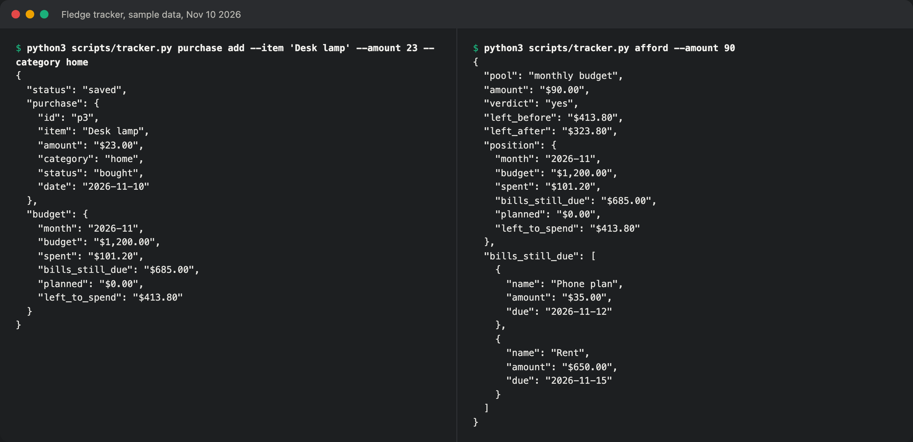

# Fledge

<p align="center">
  
  <br><em>The tracker the agent calls, logging a purchase and answering "can I afford this?" on sample data.</em>
</p>

An agent skill for new college students who are about to live on their own.

The idea for this project started in summer 2026. I wanted to help students at the point where independent life begins. Living alone and managing your own money both happen for the first time, usually along with rent, a lease, and a class schedule nobody else is keeping track of. Most of this is easy to learn, but it is also easy to miss a due date while you are learning.

You talk to the agent in normal sentences. Tell it you just spent $23 on groceries and it saves the purchase and tells you what's left this month. Ask whether you can afford a $90 jacket and it checks your bills and other plans before answering.

## What it does

- Daily briefing with classes, events, reminders, bills, deadlines, chores, and money left
- Weekly review of spending, pace for the month, and what's coming up
- Purchase log with planned, bought, and refunded items, plus a check that stops a planned item from being counted twice
- Bill tracking for one-time, weekly, monthly, and yearly bills
- "Can I afford this?" answers of yes, tight, or no
- Move-in checklist for a dorm, apartment, or house share, with its own fund so one-time costs don't distort a normal month
- Deadlines pulled from a pasted syllabus, plus flags for busy days
- Roommate expenses, where your budget only counts your share
- Grocery list, kitchen inventory, and meal ideas that use food expiring soon
- Recurring chores
- Step-by-step help with household problems, starting with when to stop and get help

It works at any school because the student supplies the dates. It will compare courses you are choosing between, but it won't recommend one or say what meets a degree requirement. That depends on each school's rules, and a wrong answer could delay graduation.

## Install

For Claude Code:

```bash
git clone https://github.com/william5711/fledge.git ~/.claude/skills/fledge
```

Then start a new session and try `just spent $23 on groceries`.

It needs Python 3.9 or newer and has no other dependencies. The tests pass on Python 3.9 through 3.13 on Linux and on Python 3.9.6 on macOS.

## Use it with other MCP clients

`scripts/mcp_server.py` exposes the tracker as 52 tools over the Model Context Protocol, so apps other than Claude Code can use the same records. Add this to your client's MCP config, with the full path to your copy:

```json
{
  "mcpServers": {
    "fledge": {
      "command": "python3",
      "args": ["/path/to/fledge/scripts/mcp_server.py"]
    }
  }
}
```

The server uses only the Python standard library. The tools come from the tracker's command parser, so a new tracker command becomes a tool once it has a description. The tests connect to it with the official MCP Python client, and the Claude Code CLI's `mcp list` check connects to it too. I haven't tested how well a model uses these tools in a real conversation, or tried it in other MCP apps.

## How it works

`SKILL.md` tells the agent how to behave, and `scripts/tracker.py` handles saving and all the math. Its code is in the `scripts/fledge/` package, with one module for each area (budget, purchases, bills, move-in, agenda, schedule, roommates, kitchen, chores, and reports), plus `storage.py` for the database and `cli.py` for the command parser. The agent doesn't add up money on its own, and amounts are stored as whole cents to avoid rounding errors. Records live in SQLite, with 14 tables, constraints that reject invalid rows, and numbered migrations for schema changes. Each write command holds a lock from reading to saving, so the skill and MCP server can't overwrite each other's changes. `references/how-to.md` is the household guide, which the agent only reads when it needs it.

You can run the tracker directly too. This example uses a date of Nov 10, 2026:

```text
$ python3 scripts/tracker.py budget set --monthly 1200
$ python3 scripts/tracker.py bill add --name Rent --amount 650 --due 2026-11-15
$ python3 scripts/tracker.py purchase add --item Groceries --amount 48.20 --category groceries
$ python3 scripts/tracker.py afford --amount 90
{
  "pool": "monthly budget",
  "amount": "$90.00",
  "verdict": "yes",
  "left_before": "$501.80",
  "left_after": "$411.80",
  "position": {
    "month": "2026-11",
    "budget": "$1,200.00",
    "spent": "$48.20",
    "bills_still_due": "$650.00",
    "planned": "$0.00",
    "left_to_spend": "$501.80"
  },
  "bills_still_due": [
    {
      "name": "Rent",
      "amount": "$650.00",
      "due": "2026-11-15"
    }
  ]
}
```

## Your data

Records are saved in a SQLite database at `~/.fledge/fledge.db` on your own computer, readable only by your user account. If you used an earlier version, your `data.json` records are imported automatically and the old file is kept. `python3 scripts/tracker.py export` prints everything as JSON. You can choose another location by setting `FLEDGE_DATA`. The tracker doesn't send anything over the network, but anything you tell the agent also goes through whichever AI service you're using. Don't give it card numbers, passwords, or Social Security numbers.

## Limits

- The calendar connection and scheduled morning briefing are only written as instructions for the agent and haven't been tested. Without a connected calendar, the briefing only knows about events you've entered.
- Amounts are shown in dollars.
- Refunds on split purchases aren't supported. Delete the shared expense and log it again.
- The household guide is general information. It hasn't been reviewed by a professional and doesn't replace emergency services, a landlord, a doctor, or a lawyer.
- It tracks money and helps with everyday budgeting, but it doesn't give investment, loan, or credit advice.

## Tests

The tests run on every push through GitHub Actions, on Python 3.9 through 3.13:

```bash
python3 -m unittest discover -s tests
```

They cover the tracker, the MCP server, and the evaluation tools, not how well an agent follows `SKILL.md` in a real conversation. For that, `evals/` has 46 scripted conversations with graded outcomes, explained in [evals/README.md](evals/README.md). I haven't published results from them yet.

## License

MIT
